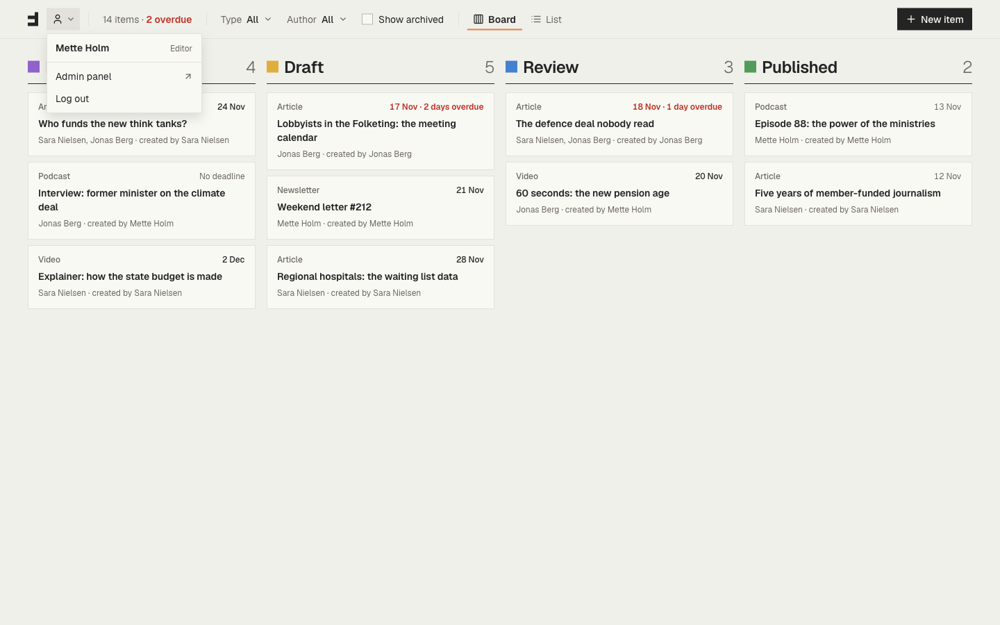
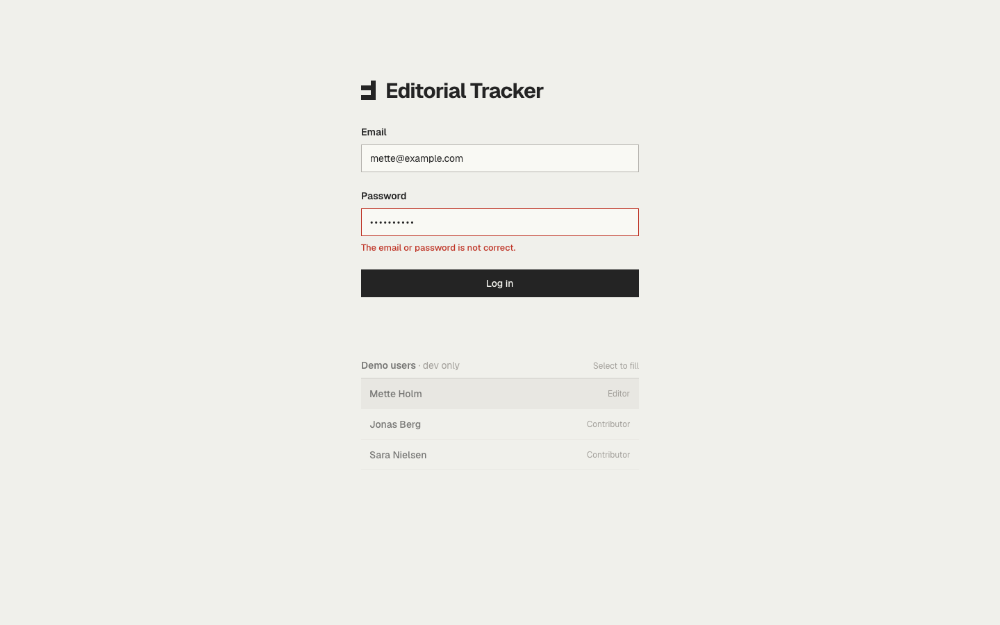
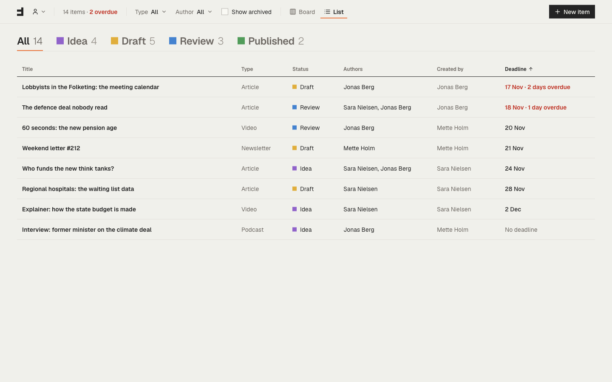
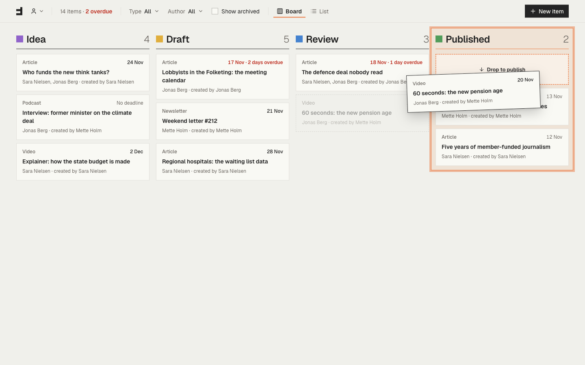
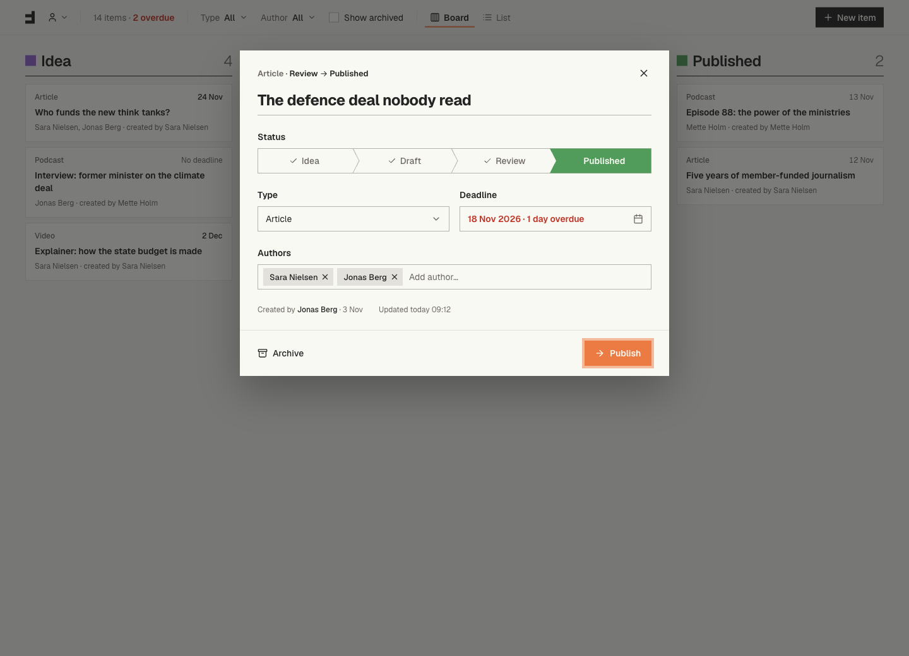
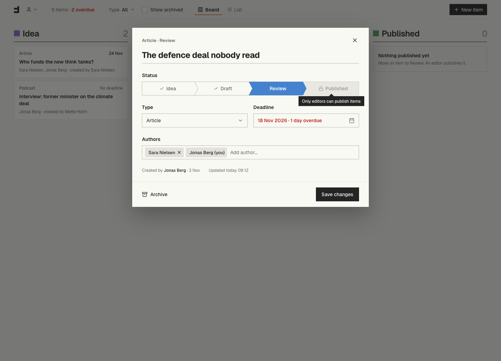
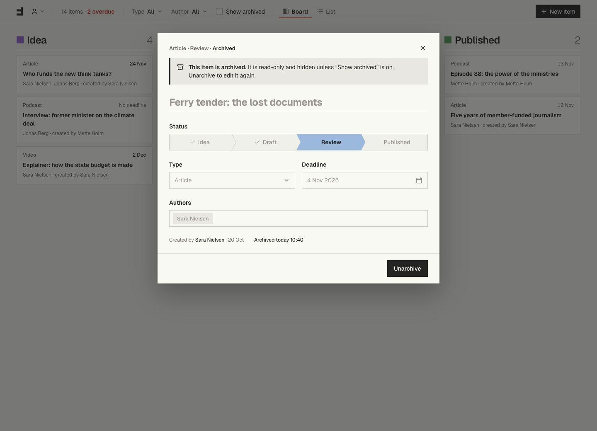

# Editorial Tracker

A small tool for a newsroom to plan content. Items (articles, videos, podcast episodes, newsletters) move through four statuses: Idea, Draft, Review and Published. Editors manage all items. Contributors manage their own items.



## Features

- Login with two roles: Editor and Contributor.
- Board view with one column per status. Drag a card to change its status.
- List view with status tabs and server-side sorting.
- Item dialog to create, edit, publish and archive an item.
- Filters for type, author and archived items. View, filters and sort are in the URL.
- Deadlines with an overdue state, computed in Europe/Copenhagen.
- Rules enforced on the server for the app, the REST API and the Admin panel.
- Live updates when other users change items.

## Stack

- [Next.js](https://nextjs.org) (App Router) with [Payload CMS 3](https://payloadcms.com) in one app
- SQLite for local use
- [shadcn/ui](https://ui.shadcn.com) and Tailwind CSS v4
- [`@dnd-kit/react`](https://dndkit.com) for drag and drop
- TypeScript (strict), pnpm, Vitest

## Run locally

Requirements: Node TODO (see `.nvmrc`), pnpm TODO.

```bash
pnpm install
cp .env.example .env   # TODO: list the variables
pnpm dev               # TODO: confirm; seeds the database on first start
```

Open http://localhost:3000. The Admin panel is at http://localhost:3000/admin (editors only).

TODO: Docker (`docker compose up`), if added.

### Demo users

| Name | Role | Email | Password |
|---|---|---|---|
| Mette Holm | Editor | TODO | TODO |
| Sara Nielsen | Contributor | TODO | TODO |
| Jonas Berg | Contributor | TODO | TODO |

The login screen lists these users in development.

### Scripts

| Command | Does |
|---|---|
| `pnpm dev` | Start the app |
| `pnpm test` | Run the tests (TODO) |
| `pnpm lint` | Lint (TODO) |
| `pnpm typecheck` | Type check (TODO) |
| `pnpm seed` | Reset and seed the database (TODO) |

## How it works

- **Permissions.** A contributor sees and changes only own items (creator or author). Only an editor can publish. Collection access gives the row scope, and a `beforeChange` hook checks values, so the rules also hold for the REST API. See [ADR 0003](docs/adr/0003-permissions-server-side.md).
- **Item view.** The item opens in a dialog over the dashboard, with its id in the URL. See [ADR 0004](docs/adr/0004-item-dialog-in-url.md).
- **Publishing.** Select the Published step, and the button changes to "Publish". Dragging a card to Published shows the same pulse. See [ADR 0009](docs/adr/0009-publish-pulse-magic-ui.md).
- **Archive.** Archive replaces delete. An archived item keeps its status, is read-only and is hidden unless "Show archived" is on.
- **Deadlines.** Plain dates, one state function, one formatter. See [ADR 0007](docs/adr/0007-deadlines-plain-dates.md).

The full rules are in [docs/spec.md](docs/spec.md). The design rules are in [docs/design-system.md](docs/design-system.md). All decisions are in [docs/adr](docs/adr/).

## Screens

| | |
|---|---|
|  |  |
|  |  |
|  |  |

All screens: [docs/design/](docs/design/).

## Assumptions and trade-offs

- "Own item" means the user created it or is an author.
- Archive is a flag, not a status. Any item can be archived.
- Contributors can move items between Idea, Draft and Review in any order. Only editors publish or unpublish.
- No success toasts and no undo. The card moving is the feedback. To undo a move, drag it back.
- Concurrent edits: the last save wins.
- Mobile: list view only. The board is for desktop.
- SQLite keeps the setup simple. Production would use Postgres.

## Not done (next steps)

- Search, "Create another", activity history, comments.
- Optimistic locking for concurrent edits.
- Realtime push (Server-Sent Events) instead of polling.
- A mobile layout for the board.
- Deployment.

TODO: update this list at the end.
