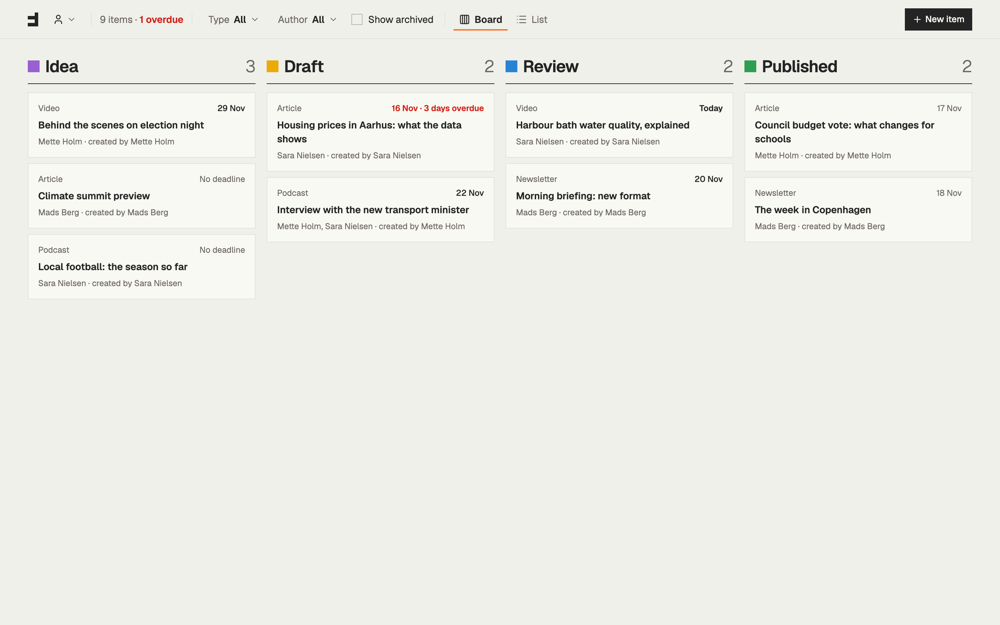
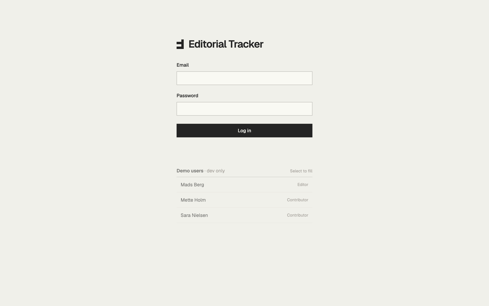
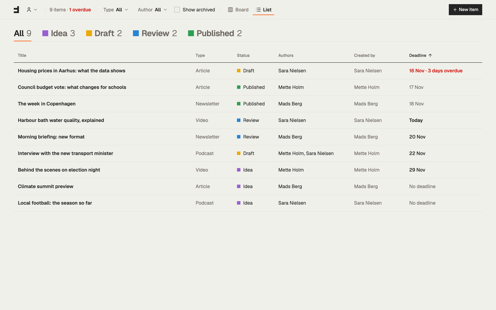
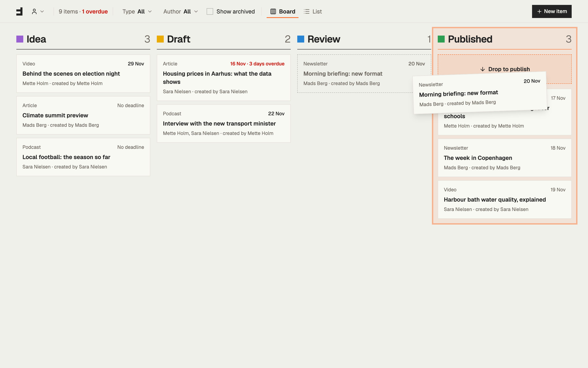
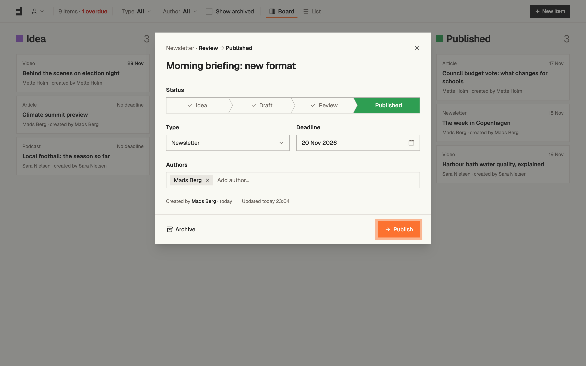
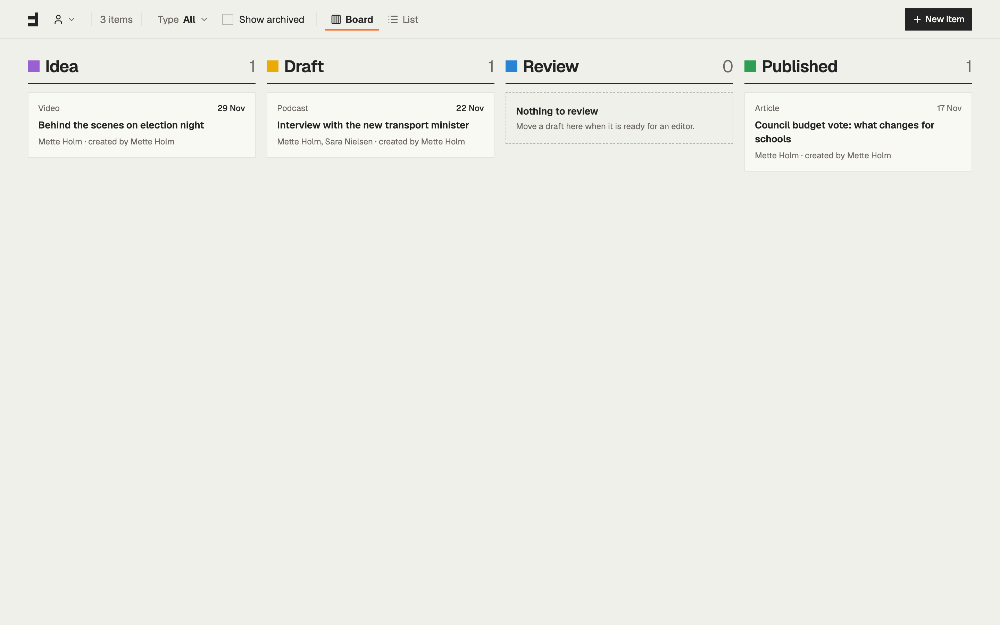
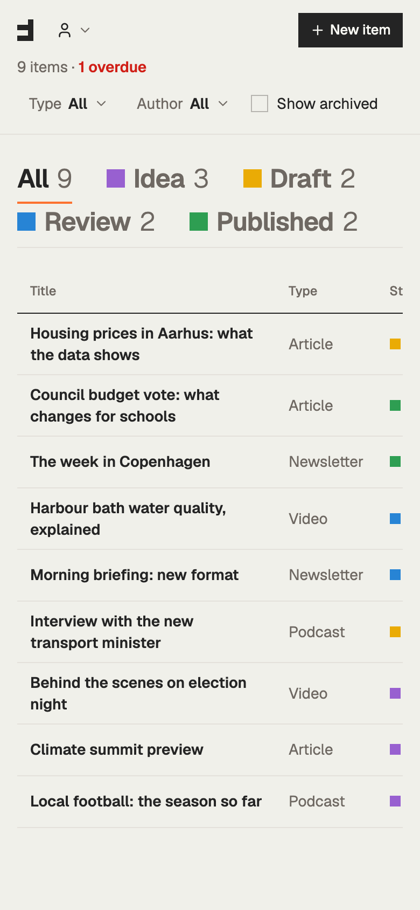

# Editorial Tracker

A small tool for a newsroom to plan content. Items (articles, videos, podcast episodes, newsletters) move through four statuses: Idea, Draft, Review and Published. Editors manage all items. Contributors manage their own items.



## Features

- Login with two roles: Editor and Contributor.
- Board view with one column per status. Drag a card to change its status.
- List view with status tabs and server-side sorting.
- Item dialog to create, edit, publish and archive an item.
- Filters for type, author and archived items. View, filters and sort are in the URL.
- Deadlines with an overdue state, computed in Europe/Copenhagen.
- Rules enforced on the server for the app, the REST API and the Admin panel.
- Live updates when other users change items.

## Stack

- [Next.js](https://nextjs.org) (App Router) with [Payload CMS 3](https://payloadcms.com) in one app
- SQLite for local use
- [shadcn/ui](https://ui.shadcn.com) and Tailwind CSS v4
- [`@dnd-kit/react`](https://dndkit.com) for drag and drop
- TypeScript (strict), pnpm, Vitest

## Run locally

### With Docker (recommended)

Requirements: Docker.

```bash
cp .env.example .env    # then set PAYLOAD_SECRET (make one with: openssl rand -hex 32)
docker compose up --build
```

Open http://localhost:3000. The Admin panel is at http://localhost:3000/admin (editors only).

Payload starts on the first request. Then it seeds the demo data when the database has no users.

The database is in the Docker volume `data`. To start again with an empty database, run `docker compose down -v`.

### With Node

Requirements: Node 24.22.3 (see `.nvmrc`) and pnpm 10.28.2 (see `packageManager` in `package.json`). `corepack enable` installs the correct pnpm version.

```bash
nvm use                 # or another tool that reads .nvmrc
corepack enable
pnpm install
cp .env.example .env    # then set PAYLOAD_SECRET
pnpm dev                # start the app
```

On the first start, the app seeds the demo data when the database has no users.

| Variable | Use |
|---|---|
| `DATABASE_URL` | The SQLite file. Default: `file:./editorial-tracker.db`. |
| `PAYLOAD_SECRET` | The secret for auth tokens. Make one with `openssl rand -hex 32`. |
| `SEED_ON_START` | `false` turns off the seed on first start. Default: on. |
| `COOKIE_SECURE` | `true` sends the session cookie only over HTTPS. Set it behind HTTPS. Default: off (Docker uses plain http). |

### Demo users

| Name | Role | Email | Password |
|---|---|---|---|
| Mads Berg | Editor | mads@example.com | `demo-password` |
| Mette Holm | Contributor | mette@example.com | `demo-password` |
| Sara Nielsen | Contributor | sara@example.com | `demo-password` |

The login screen lists these users only in development (`pnpm dev`). Select a user to fill the form.

A session lasts 8 hours. After 5 failed logins, an account is locked for 10 minutes.

### Scripts

| Command | Does |
|---|---|
| `pnpm dev` | Start the app in development mode |
| `pnpm build`, `pnpm start` | Build and start the production app |
| `pnpm check` | Run all checks: typecheck, lint, format check, audit, tests. The pre-commit hook runs it. |
| `pnpm test` | Run the unit and integration tests (Vitest) |
| `pnpm typecheck` | Type check |
| `pnpm lint` | Lint (ESLint) |
| `pnpm format`, `pnpm format:check` | Format the code, or check the format (Prettier) |
| `pnpm audit` | Check the dependencies for known advisories (moderate and higher) |
| `pnpm generate:types` | Generate `src/payload-types.ts` after a change to a collection |
| `pnpm payload migrate:create <name>` | Create a database migration after a change to a collection |
| `pnpm seed` | Delete all users and items, then seed the demo data (development only) |

## How it works

- **Permissions.** A contributor sees and changes only own items (creator or author). Only an editor can publish. Collection access gives the row scope, and a `beforeChange` hook checks values, so the rules also hold for the REST API. See [ADR 0003](docs/adr/0003-permissions-server-side.md).
- **Login.** A Server Action logs in with Payload and sets the `payload-token` cookie. The app and the Admin panel share the session. Logout ends the session on the server. See [ADR 0011](docs/adr/0011-auth-and-session.md).
- **Dashboard.** The URL holds the view, the filters and the list state (`?view=list`, `?type=article`, `?author=<id>`, `?archived=1`, `?status=draft`, `?sort=title&dir=desc`, `?item=12`, `?item=new`), so you can share a filtered view. The server loads the items as the logged-in user, builds the board and sorts the list. On small screens the list is the only view. The counts and the cards use the same deadline rule.
- **Item view.** The item opens in a dialog over the dashboard, with its id in the URL. Server Actions save the item as the logged-in user; the same server rules apply. See [ADR 0004](docs/adr/0004-item-dialog-in-url.md).
- **Live updates.** Every 5 seconds, and when the window gets focus, the dashboard asks the server for a small version of the items that the user can read. When the version changes, the page loads the new data. The check pauses while the tab is hidden, during unsaved edits and during a drag. See [ADR 0008](docs/adr/0008-live-updates-polling.md).
- **Publishing.** In the item dialog, select the Published step. The button changes to "Publish" and pulses. A card that you drag to Published shows the same pulse. See [ADR 0009](docs/adr/0009-publish-pulse-magic-ui.md).
- **Archive.** Archive replaces delete. An archived item keeps its status, is read-only and is hidden unless "Show archived" is on.
- **Deadlines.** Plain dates, one state function, one formatter. See [ADR 0007](docs/adr/0007-deadlines-plain-dates.md).

The full rules are in [docs/spec.md](docs/spec.md). The design rules are in [docs/design-system.md](docs/design-system.md). All decisions are in [docs/adr](docs/adr/).

## Screens

Screenshots of the app with the demo data:

| | |
|---|---|
|  |  |
|  |  |
|  |  |


## Supply-chain safety

A hijacked npm package is usually found and removed within a few days. So this repo waits before it uses a new release.

- **28-day rule.** pnpm installs only package versions that are 28 days old or older (`minimumReleaseAge` in `pnpm-workspace.yaml`). The rule applies on every machine, in CI and in the Docker build. The GitHub Actions follow the same rule.
- **Exact versions.** The lockfile holds the exact versions. CI and Docker install with `--frozen-lockfile`. Payload and Next.js have exact pins in `package.json`. The GitHub Actions are pinned to a commit SHA.
- **Install scripts.** Only the packages in `onlyBuiltDependencies` can run install scripts.
- **Audit.** `pnpm check` runs `pnpm audit` and fails on moderate or higher advisories. Fixes for sub-dependencies are in `overrides`. Unused optional packages are not installed.
- **Few dependencies.** Unused starter parts are removed. The shadcn CLI is not a runtime dependency (`shadcn eject`).

Exceptions:

- **Node.js.** Node does not come from npm, and the Node project signs its releases. A Node security release fixes known holes, so a wait is the risk, not the release. Thus `.nvmrc` can use a Node security release that is younger than 28 days.
- **Critical advisories.** If an advisory is critical and can hurt this app, take the fix for that one version, also if it is younger than 28 days. Write down why. Then return to the rule.

Known advisories that `pnpm audit` ignores (`auditConfig.ignoreGhsas`):

| Package | Advisory | Why it does not affect this app | Fix allowed from |
|---|---|---|---|
| `next` 16.4.2 | GHSA-mfr8-8qww-v76h, GHSA-vc7v-qv4w-wrv8 | Only with `'use cache'` and root params. The app does not use them. | 2026-12-01 (16.4.5) |
| `minimatch` 10.2.6 | GHSA-g3hv-75wg-m249 | Dev only (ESLint parser), with our own patterns. | 2026-11-24 (11.0.1) |

TODO: on these dates, upgrade the package and remove its entries from `ignoreGhsas`.

## Assumptions and trade-offs

- "Own item" means the user created it or is an author.
- Archive is a flag, not a status. Any item can be archived.
- Contributors can move items between Idea, Draft and Review in any order. Only editors publish or unpublish.
- No success toasts and no undo. The card moving is the feedback. To undo a move, drag it back.
- Concurrent edits: the last save wins.
- Mobile: list view only. The board is for desktop.
- SQLite keeps the setup simple. Production would use Postgres.

## Not done (next steps)

- Search, "Create another", activity history, comments.
- Optimistic locking for concurrent edits.
- Realtime push (Server-Sent Events) instead of polling.
- A mobile layout for the board.
- Deployment.
- End-to-end tests (Playwright).
- A CI check that the migrations match the collections.
